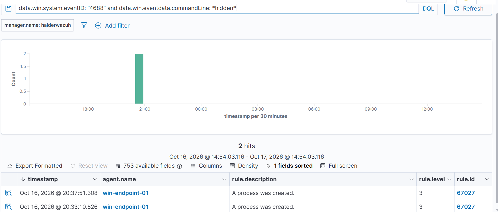
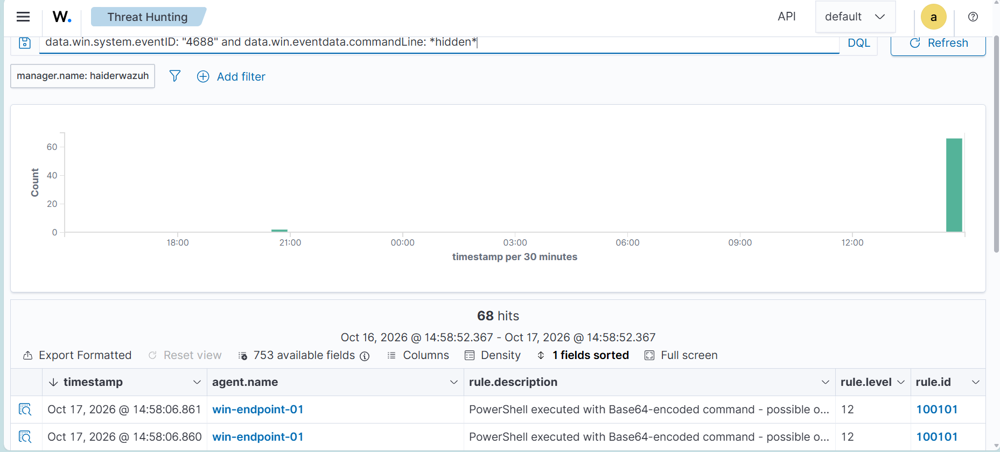

# SOC Analyst Portfolio

**Umair Haider** — detection engineering, incident investigation, and threat intelligence from a self-built SOC lab.

Background: software engineering, plus eight years in military technical roles. Working toward a Tier 1 SOC analyst position.

---

## Highlight: closing a detection gap

Coverage testing found that Wazuh's default ruleset produced an identical informational alert for a PowerShell dropper and for opening a text file.

```
powershell.exe -nop -w hidden -enc <base64>   →  rule 67027, level 3, "A process was created"
notepad.exe notes.txt                         →  rule 67027, level 3, "A process was created"
```

In a SOC filtering above level 5, the dropper would not have reached an analyst. The telemetry was complete — `commandLine` contained every flag — so the gap was in detection logic, not collection.

Three rules close it:

| Rule | Level | Detects |
|---|---|---|
| 100100 | 8 | Concealment or execution-policy bypass flags |
| 100101 | 12 | Base64-encoded command |
| 100102 | 14 | Office application spawning a command interpreter |

**Result on live telemetry** — the same event, before and after:





Rule 100102 matches the parent–child process relationship rather than command-line content, so it survives payload obfuscation — detection at the TTP level rather than the artefact level. It also closes the T1566.001 gap identified as highest priority in the FIN7 threat profile.

→ **[detection-engineering/detection-rules.md](detection-engineering/detection-rules.md)** — design reasoning, testing methodology, and six documented findings.

---

## Contents

| Area | What it demonstrates |
|---|---|
| **[detection-engineering/](detection-engineering/)** | Writing, testing and tuning custom SIEM rules; alert-volume and false-positive reasoning |
| **[investigations/](investigations/)** | Evidence-bounded incident analysis and written reporting |
| **[threat-intelligence/](threat-intelligence/)** | Threat-informed coverage gap analysis with MITRE ATT&CK Navigator |
| **[lab/](lab/)** | Building and operating the monitoring infrastructure |
| **[playbooks/](playbooks/)** | Repeatable triage procedure with explicit decision criteria |

---

## Lab architecture

Two physical hosts, deliberately separated.

```
Device 2 (monitored)                    Device 1 (monitoring)
┌──────────────────────────┐           ┌─────────────────────┐
│  Windows endpoint        │           │  Wazuh 4.14         │
│   ├─ NIC1: isolated net  │           │  manager + indexer  │
│   └─ NIC2: agent path ───┼─── LAN ───┼──→ :1514 / :1515    │
└──────────────────────────┘           └─────────────────────┘
```

Monitoring infrastructure and monitored systems sit on separate physical hosts, and the SIEM's host firewall permits inbound traffic only on the agent ports from the endpoint address.

The reasoning: a SIEM reachable from a compromised endpoint is evidence an attacker can destroy. Separating the monitoring plane is standard production practice; the firewall restriction applies the same principle at the host level.

→ **[lab/lab-build-log.md](lab/lab-build-log.md)** — build steps, configuration decisions, and the problems encountered.

---

## Selected findings

Three things learned by getting them wrong first.

**Test path must match threat path.** A brute-force correlation rule failed validation at the Windows lock screen, which enforces a cooldown after repeated failures. That cooldown belongs to the logon interface, not to authentication — real brute force happens over the network, where no such limit applies. Widening the rule's window would have tuned it to an artefact of the test rather than to the threat.

**Rule topology affects alert volume independently of rule accuracy.** Two correct rules chained in parallel produced two alerts for one event. Both were right; the arrangement was not.

**A detection is coupled to its decoder, not just its fields.** Synthetic test events decoded correctly but never entered the Windows rule tree, so no rule could match. Testing with hand-built data requires reproducing the ingestion path, not only the field content.

---

## Honest limitations

- **No Sysmon.** Native Windows 4688 lacks process hashes and per-process network attribution. Adding Sysmon would enrich every rule here.
- **Single endpoint.** False positive behaviour at scale is untested.
- **No email telemetry.** T1566.001 coverage detects the consequence of a malicious attachment, not its arrival.
- **Correlation rules unvalidated.** Deployed and loading cleanly, but the lab has no domain controller or network authentication services, so sustained authentication failure is not reproducible here. Recorded as an open item rather than adjusting thresholds to match what the environment can produce.

---

## A note on redaction

The phishing analysis examines a real sample. Recipient identifiers are redacted, URLs and domains are defanged, and no live payload is reproduced. Lab addressing is internal and non-routable. Credentials are excluded from version control.

---

## Certifications

CompTIA Security+ — *in progress*
