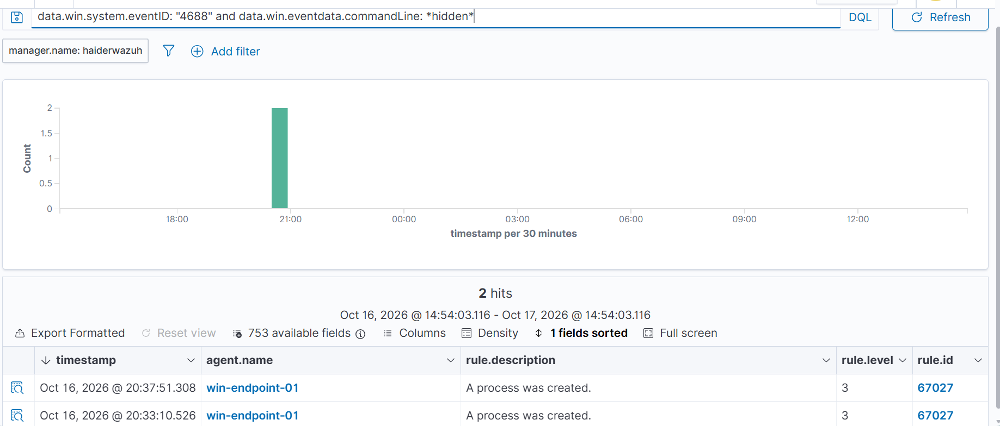
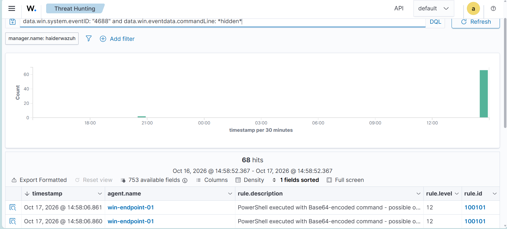

# Custom Detection Rules — Windows Endpoint

**Analyst:** Umair Haider
**Platform:** Wazuh 4.14.8 (manager: `haiderwazuh`)
**Monitored endpoint:** `win-endpoint-01` (Windows, agent-based collection)
**Date:** October 2026

---

## Objective

Close a detection gap identified during coverage testing, where PowerShell executed with obfuscation and concealment flags generated only an informational alert indistinguishable from benign process creation.

Related documents: `lab-build-log.md` (infrastructure), `incident-003-lab-detections.md` (coverage assessment that surfaced this gap).

---

## Gap Identified

Wazuh's default ruleset generates **rule 67027 — "A process was created", level 3** for every Windows Event ID 4688, regardless of command-line content.

Evidence from coverage testing:

| Command executed | Rule fired | Level |
|---|---|---|
| `notepad.exe notes.txt` | 67027 | 3 |
| `powershell.exe -nop -w hidden -enc <base64>` | 67027 | 3 |

A dropper using concealment and Base64 encoding produced the **same alert as opening a text file**. In a SOC filtering its queue above level 5 — standard practice to control analyst load — this activity would be invisible.

**The data was present and correctly parsed.** `win.eventdata.commandLine` contained the full invocation including all flags. The gap was in detection logic, not collection.

---

## Rules Implemented

Deployed to `/var/ossec/etc/rules/local_rules.xml`. Rule IDs in the 100000+ range, reserved for custom rules so vendor upgrades do not overwrite them.

```xml
<group name="windows,custom_powershell,">

  <!-- Base: PowerShell launched with a concealment or policy-bypass flag -->
  <rule id="100100" level="8">
    <if_sid>67027</if_sid>
    <field name="win.eventdata.newProcessName" type="pcre2">(?i)powershell(_ise)?\.exe$</field>
    <field name="win.eventdata.commandLine" type="pcre2">(?i)\s-(w(indowstyle)?\s+hidden|nop(rofile)?\b|e(x|xecution)?p(olicy)?\s+bypass)</field>
    <description>PowerShell executed with concealment or execution-policy bypass flag</description>
    <mitre>
      <id>T1059.001</id>
    </mitre>
  </rule>

  <!-- Escalation: encoded command present -->
  <rule id="100101" level="12">
    <if_sid>100100</if_sid>
    <field name="win.eventdata.commandLine" type="pcre2">(?i)\s-(e|ec|enc|encod\w*)\s+[A-Za-z0-9+/=]{20,}</field>
    <description>PowerShell executed with Base64-encoded command - possible obfuscated payload</description>
    <mitre>
      <id>T1059.001</id>
      <id>T1027</id>
    </mitre>
  </rule>

  <!-- Highest: Office application spawning a command interpreter -->
  <rule id="100102" level="14">
    <if_sid>67027</if_sid>
    <field name="win.eventdata.parentProcessName" type="pcre2">(?i)(winword|excel|powerpnt|outlook|msaccess)\.exe$</field>
    <field name="win.eventdata.newProcessName" type="pcre2">(?i)(powershell|cmd|wscript|cscript|mshta)\.exe$</field>
    <description>Office application spawned a command interpreter - likely macro-based execution</description>
    <mitre>
      <id>T1059.001</id>
      <id>T1566.001</id>
    </mitre>
  </rule>

</group>
```

| ID | Level | Detects | ATT&CK |
|---|---|---|---|
| 100100 | 8 | Concealment or execution-policy bypass flags | T1059.001 |
| 100101 | 12 | Base64-encoded command (escalation of 100100) | T1059.001, T1027 |
| 100102 | 14 | Office application spawning an interpreter | T1059.001, T1566.001 |

---

## Design Reasoning

### Severity tracks confidence, not technique

A hidden window alone has legitimate uses — some installers and management tooling suppress console output. Level 8 means *review this*. An encoded command is substantially rarer in legitimate software, so level 12. An Office application spawning a shell has close to no legitimate explanation, so level 14.

Assigning uniform severity to all three would either flood the queue with low-confidence alerts or under-rate the high-confidence one.

### Rule 100102 matches behaviour, not payload

Rule 100102 does not inspect the command line at all. It matches the **parent-child process relationship**.

This matters because an attacker can obfuscate a payload indefinitely — base64, string concatenation, XOR, custom encoders — but a macro still has to spawn a child process to execute anything. The relationship is far more durable than the artefact.

In Pyramid of Pain terms, rules 100100 and 100101 detect at the *artefact* level and 100102 detects at the *TTP* level. Forcing an adversary to change technique is considerably more expensive than forcing them to re-encode.

This rule closes the T1566.001 gap identified as the highest-priority uncovered technique in `fin7-threat-profile.md`.

---

## Correlation Rules

Rules 100100–100102 are stateless — each evaluates a single event. Brute force cannot be detected that way, because no individual failed logon is anomalous. The signal is in the pattern: how many, how fast, against whom, and what followed. Rules 100200–100202 hold state across a time window.

| ID | Level | Logic | Grouping key | ATT&CK |
|---|---|---|---|---|
| 100200 | 10 | N failures within timeframe | Same target account | T1110.001 |
| 100201 | 11 | N failures across differing accounts | Same source address | T1110.003 |
| 100202 | 13 | Success after 100200 fired | Same target account | T1110.001, T1078 |

### Why 100202 carries the highest severity

A burst of failures is an attempt. A success following that burst is a compromise. The severity reflects the change in verdict, not the volume of events — the same reasoning applied manually in incident-001, now encoded as a rule.

### Finding: preventive control constrains detective control

Testing rule 100202 triggered Windows account lockout (rule 60115, Event ID 4740) at the 10th failed attempt. Because the account locks before authentication can succeed, rule 100202 cannot fire for a standard brute force against a lockout-enabled account.

The rule retains value for the cases lockout does not cover:

- Password spraying, which stays below the lockout threshold by design
- Accounts exempt from lockout policy, commonly the built-in Administrator
- Environments where lockout is not configured

Rule 100201 is therefore the more operationally relevant of the two in a lockout-enabled environment, and rule 60115 is itself high-value — a lockout event means someone generated enough failures to trip the threshold.

**Takeaway:** detection coverage must be assessed against the preventive controls already in place. A detection that cannot fire because another control intervenes first is not wasted, but its real coverage is narrower than the rule logic suggests.

### Finding: test path must match threat path

Rule 100200 (frequency 8, timeframe 120) did not fire during testing via the Windows lock screen. Timestamp analysis showed 6 failures in 6.5 seconds, then a system-enforced cooldown of approximately 127 seconds before further attempts were accepted. Across the full sequence, 9 failures spanned 139 seconds — no 120-second window contained the required 8.

The initial diagnosis was that the rule's threshold was too tight. That was wrong. The cooldown is a property of the interactive logon interface, not of Windows authentication. Network-based authentication — SMB, RDP, LDAP, WinRM — imposes no equivalent limit and sustains far higher rates, which is how brute force actually occurs, since an attacker is not sitting at a console.

Widening the timeframe to accommodate the lock-screen cooldown would have tuned the rule to an artefact of the test method rather than to the threat. The rule was left unchanged and the test method was reconsidered instead.

**Takeaway:** a detection must be validated against the delivery path the threat actually uses. An unrepresentative test produces either a false negative or, worse, a rule retuned to match the test. A rule that does not fire is not necessarily misconfigured — verify the input matched the stated condition before changing the rule.

### Status: deployed, validation incomplete

Rules 100200–100202 are deployed and load cleanly, verified with `wazuh-analysisd -t`. End-to-end validation was not completed.

Three authentication paths were attempted:

- **Interactive lock screen** — system-enforced cooldown capped the rate below the rule threshold
- **SMB to the local admin share** — no authentication events generated
- **Direct credential validation API** — no authentication events generated

The lab is a standalone Windows workstation with no domain controller and no network authentication services exposed. Sustained high-rate authentication failure is not reproducible in this environment.

Validation requires a domain-joined test environment or a second host able to authenticate across the network. Recorded as an open item rather than adjusting the rules to match what this environment can produce — a threshold tuned to an unrepresentative test is worse than an unvalidated one.

## Testing Methodology

Rules were validated with `wazuh-logtest` before deployment, then confirmed against live telemetry.

### Finding: synthetic events bypass the Windows rule tree

Hand-crafted JSON events pasted into `wazuh-logtest` produced **Phase 1 and Phase 2 output but no Phase 3** — no rule matched, including the built-in rule 67027 that was demonstrably firing on live traffic.

Phase 2 revealed the cause:

```
**Phase 2: Completed decoding.
        name: 'json'
```

The generic `json` decoder had matched, not `windows_eventchannel`. Wazuh's entire Windows ruleset chains from a parent rule requiring `<decoded_as>windows_eventchannel</decoded_as>`, so the event never entered that rule tree — despite every field decoding correctly.

**Takeaway:** a rule is coupled not only to field names but to the decoder that produces them. Testing with synthetic data requires reproducing the ingestion path, not merely the field content. A test that passes or fails on synthetic input says nothing about production behaviour unless the decoder path matches.

Validation was performed against live agent telemetry instead, which is the authoritative check regardless.

### Finding: field names differ between native auditing and Sysmon

Initial drafts used `win.eventdata.image` and `win.eventdata.parentImage`. Those are **Sysmon** field names. Native Windows Event ID 4688 uses `newProcessName` and `parentProcessName`.

The rules matched nothing until corrected. Confirmed by inspecting decoded field names in `wazuh-logtest` Phase 2 output.

**Takeaway:** detection rules are tightly coupled to their data source. If Sysmon is introduced later, these rules require parallel variants — the same logical detection expressed against different field names.

---

## Validation Results

Live test on `win-endpoint-01`:

```powershell
powershell.exe -nop -w hidden -enc RwBlAHQALQBEAGEAdABlAA==
```

Query: `data.win.system.eventID: "4688" and data.win.eventdata.commandLine: *hidden*`

| | Rule | Level | Description |
|---|---|---|---|
| **Before** | 67027 | 3 | A process was created. |
| **After** | 100101 | 12 | PowerShell executed with Base64-encoded command - possible obfuscated payload |

Identical query, identical event type. The event moved from informational noise to a level 12 alert carrying ATT&CK attribution.


*Before: rule 67027, level 3 — "A process was created"*


*After: rule 100101, level 12 — "PowerShell executed with Base64-encoded command"*

---

## Post-Deployment Findings

### Finding: alert duplication from parallel rule chaining

Initial deployment chained **both** 100100 and 100101 from rule 67027. A single PowerShell execution carrying both a concealment flag and an encoded command therefore matched both rules independently and generated **two alerts for one event**.

Observed as a disproportionate alert count during validation, with paired entries milliseconds apart.

**Resolution:** rule 100101 now chains from `100100` rather than `67027`. Wazuh emits the final rule in a chain, so the escalation supersedes the base alert rather than duplicating it — one event, one alert, at the higher severity.

**Trade-off accepted:** 100101 now inherits 100100's requirement for a concealment flag. An encoded command issued *without* `-hidden`, `-nop`, or `-ep bypass` will no longer match 100101.

This was a deliberate choice. In the observed threat data, encoding is near-universally paired with at least one concealment flag, and the alert-volume cost of parallel firing outweighs the narrow coverage loss. If telemetry later showed encoded commands appearing alone, the correct fix would be a separate rule chained from 67027 with its own severity rather than reverting to parallel chaining.

**Takeaway:** rule topology affects alert volume independently of rule accuracy. Both rules were individually correct; their arrangement was not. Alert fatigue is a detection failure mode even when every rule fires correctly.

---

## False Positive Considerations

**Rules 100100 and 100101** may fire on legitimate activity:

- Configuration management tooling (SCCM, Intune, Ansible) frequently invokes PowerShell with `-nop` and hidden windows
- Some software installers use encoded commands during setup
- Scheduled maintenance scripts written by administrators

**Tuning approach if deployed in production:** scope exceptions by parent process, invoking user account, and host role — not by disabling the rule. For example, exclude invocations where the parent is a known management agent *on servers in the management OU*, while leaving detection intact on user workstations.

A scoped, documented exception preserves coverage. Disabling the rule creates a permanent blind spot that nobody revisits.

**Rule 100102** is expected to be low-noise. Legitimate Office-to-interpreter spawning is rare outside of deliberately scripted environments. If an organisation does use Office macros operationally, the exception should be scoped to the specific document set and signing certificate rather than the technique.

---

## ATT&CK Coverage Added

| Technique | ID | Rule | Confidence |
|---|---|---|---|
| Command and Scripting Interpreter: PowerShell | T1059.001 | 100100, 100101, 100102 | High |
| Obfuscated Files or Information | T1027 | 100101 | Medium |
| Phishing: Spearphishing Attachment (execution stage) | T1566.001 | 100102 | Medium |

Note on T1566.001: rule 100102 detects the *consequence* of a malicious attachment being opened, not the attachment's arrival. Full coverage of T1566.001 requires email gateway telemetry, which this lab does not have. Recorded as partial coverage rather than complete.

---

## Limitations and Future Work

- **No Sysmon.** Native 4688 lacks process hashes, image load events, and network connection attribution per process. Adding Sysmon would enrich all three rules and enable hash-based threat intelligence correlation.
- **Single endpoint.** Rules are validated against one Windows host. Behaviour at scale — particularly false positive rate — is untested.
- **No email telemetry.** T1566.001 coverage is partial for the reason noted above.
- **No automated regression testing.** Rule changes are currently validated manually. A test corpus of known-good and known-bad events replayed after each change would catch regressions, and is the natural next step.

---

## Files

| Path | Contents |
|---|---|
| `local_rules.xml` | Rule definitions as deployed to `/var/ossec/etc/rules/` on the manager |
| `evidence/` | Before/after dashboard screenshots |

## Kerberoasting (T1558.003) — Rules 100110, 100111

**Status:** Syntax-checked and loaded. Logic unvalidated — no domain controller in lab.

**What it detects:**
It detects an attacker with any domain account requesting a service tickets so that he can crack password offline.

**Data source:**
Its Event 4769 in the security logs on domain controller. Needs “Audit Kerberos Service Ticket Operations” turned on.

**Rule 100110 — level 8:**
It gets one event 4769 with 0x17 encryption and that service not be a computer account, its medium level because a single RC4 ticket can be from a legitimate legacy application. 

**Rule 100111 — level 12:**
the same one account triggers rule 100110 for 5 or more different services within 5 mins, an attack tools request every SPN within seconds.

**Parent rule note:**
60106 matches both 4624 and 4769, so without ^4769$, rule 100110 would check every successful logon. Also, 10110 is missing a zero.

**Expected false positives:**
Legacy applications or service accounts configured to allow only RC4

**Known evasion:**
Attacker requests AES tickets and that will avoids the RC4 signal

**Stronger alternative:**
honeypot SPN, a fake service account with an SPN nothing have real use. Any request for it is malicious because legit user never gets it. near zero false positives and it catches AES requests too

**Validation plan:**
Test domain controller, a service account with SPN and tools requests service tickets in bulk, confirm both rules fires.