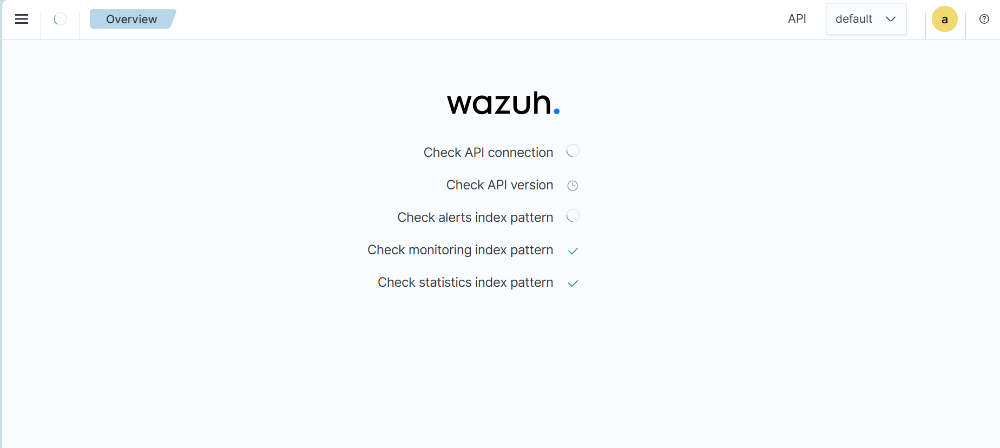
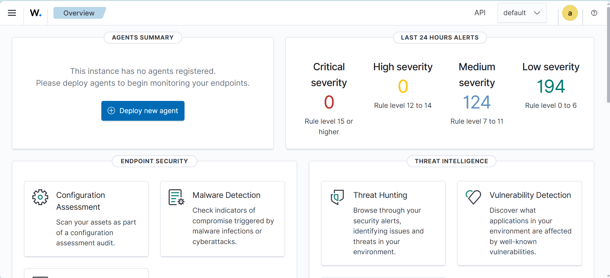

# Home SOC Lab — Build Log
**Analyst:** Umair Haider  **Started:** 2026-10-07

## Objective
Build a working detection pipeline: Windows endpoint → Wazuh SIEM,
generate simulated attack activity, detect and triage it, map to MITRE ATT&CK.

## Design Decisions
### Why two physical hosts
Monitoring infrastructure and monitored systems are separated across
devices so that compromise of the lab endpoint cannot reach the SIEM.
This mirrors production practice where the SIEM sits in a management
network, and preserves evidence integrity during simulated intrusions.
### Why the endpoint is dual-homed
NIC1 (isolated internal network) is reserved for simulated attack traffic
from an attacker VM, so that offensive activity never traverses the
monitoring path. NIC2 (bridged) carries agent telemetry only, restricted
at the SIEM host firewall to ports 1514/1515 from the endpoint address.
The attacker VM was deferred — see Deviation from original plan below —
so NIC1 is currently unused.
### Why Wazuh on the 16GB host
The all-in-one deployment includes manager, indexer and dashboard,
which require 8GB to perform acceptably for log search.

## Build: Wazuh Manager (Device 1)
**Date:** 2026-10-12  **Wazuh version:** 4.14

| Setting | Value |
|---|---|
| VM RAM / CPU / Disk | 8 GB / 4 cores / 50 GB |
| Static IP | 10.0.0.50 (lab-internal) |
| Install method | Assisted all-in-one (indexer + server + dashboard) |

### Why 8 GB and 4 cores
Official requirement for 1–25 agents is 4 vCPU / 8 GB / 50 GB. The bundled
Wazuh Indexer is Elasticsearch-derived and CPU-intensive during ingestion.

### Deviation from original plan
Kali deferred. Device 2 has 4 GB free, which cannot run Windows and Kali
concurrently. Initial detections are generated natively on the endpoint
(authentication failures, PowerShell execution, persistence mechanisms),
which requires no attacker VM. Kali will be added on Device 1 when
network-based attack simulation is needed.

### Finding: allocated disk size is not usable filesystem size

Ubuntu Server's guided LVM installation allocated only ~24 GB of the
50 GB virtual disk to the root logical volume, leaving the remainder
unclaimed in the volume group. Wazuh requires 50 GB for 1-25 agents at
90-day retention.

Identified with `df -h` during troubleshooting of a stalled installation.
Resolved with `lvextend -l +100%FREE` followed by `resize2fs`, bringing
the filesystem to 48 GB.

Takeaway: verify actual filesystem capacity after installation. Allocated
disk size and usable filesystem size are not the same thing, and the
difference does not surface until something fails.

### Incident: installation stalled at indexer deployment

The assisted installation hung at "Starting Wazuh indexer installation"
for approximately 40 minutes with no further log output.

Diagnosis sequence:
- `tail -f /var/ossec/logs/wazuh-install.log` confirmed no progress
- `free -h` ruled out memory (7.8 GB total, 6.8 GB free)
- `nproc` confirmed 4 cores
- `ps aux` showed no active apt, dpkg or java processes
- `df -h` revealed the undersized filesystem above

Two contributing factors were identified: the constrained disk, and a
second installer invocation started while the first held the dpkg lock.
dpkg permits a single writer, so the second process waited indefinitely
with no error message.

Resolved by expanding the filesystem, running `wazuh-install.sh --uninstall`
to clear partial state, rebooting, and running the installer once.

Takeaway: a process that appears hung is not necessarily working slowly.
Checking resources systematically — memory, CPU, disk, running processes —
located a root cause that had no relationship to the error message.

### Incident: network configuration applied over the connection it changed
Applied netplan config over SSH; the address change terminated the session
before the change could be confirmed. Reapplied from the VM console instead.
Takeaway: network configuration changes must be made out-of-band, not over
the connection they will alter — which is the operational reason production
systems have dedicated management access.

### Incident: ruleset syntax error caused manager outage
A correlation rule used `timeframe` as a child element rather than a rule
attribute. wazuh-analysisd refused to load the ruleset and the manager
failed to start, leaving the SIEM down from 14:24 until 14:35.

Root cause identified from /var/ossec/logs/ossec.log:
  ERROR: Invalid option 'timeframe' for rule '100202'

Process change: validate with `wazuh-analysisd -t` before any restart.
A ruleset error does not degrade the manager gracefully — it prevents
startup entirely, so detection stops completely rather than partially.

### Secondary finding: silent rule rejection
An invalid `if_sid` value produced a WARNING rather than an error.
The manager starts normally and the affected rule is discarded without
further notice. This is a more dangerous failure mode than the parse
error that caused the outage: detection coverage is silently absent
while appearing configured.

`wazuh-analysisd -t` surfaces both. Treating any warning as blocking —
not just errors — is the correct standard for ruleset changes.

## Known Limitations
- Bridged NIC2 shares the home LAN rather than a dedicated management
  VLAN; consumer routing hardware does not support VLAN separation.
  Compensating control: host firewall restricts the path to agent ports only.
- No redundancy; single SIEM instance with no backup of alert data.

## Evidence

*Post-install module status — API connectivity confirmed, alerting and monitoring components active.*

*Dashboard overview following agent enrolment.*
